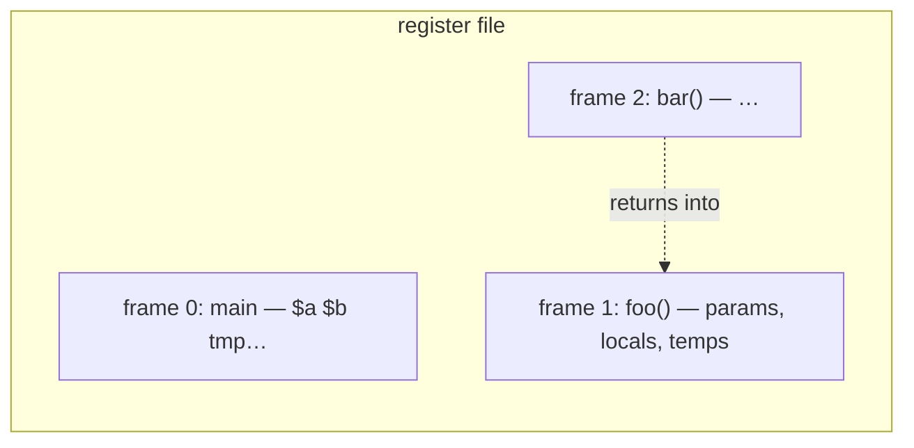
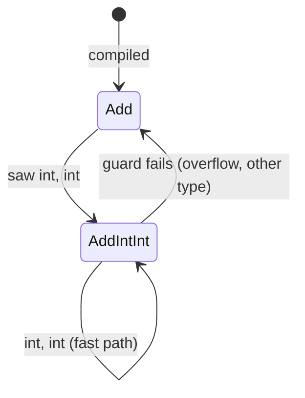
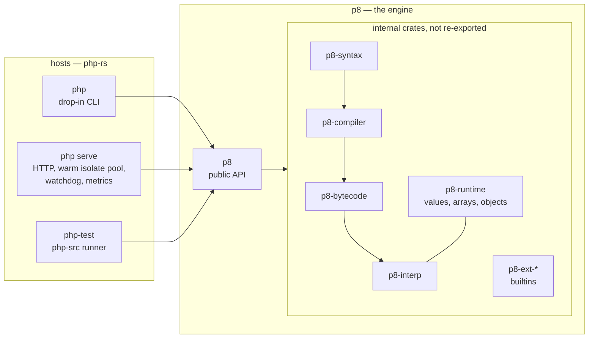
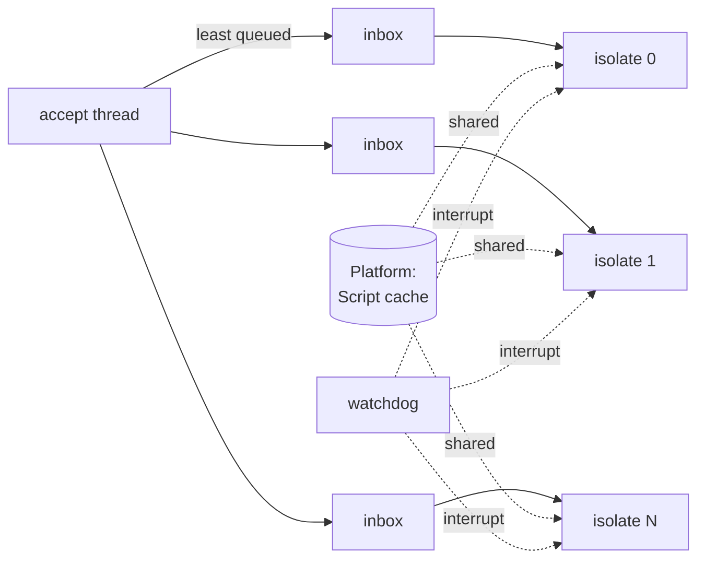

# p8: a correct, safe and fast PHP engine

Status: proposed (decisions taken by Sami, 22 Oct 2026; details open for review).
The new core was called "engine v2" while it was being built; its name is **p8**.

## Why

The current VM gives PHP's answers on a growing share of the php-src suite
(25% of the 16,077 tests real PHP 8.4 passes), but it is built to be slow:

| hot path | what the current VM does |
|---|---|
| user function call | looks the name up among ~1,500 builtins first: lowercases it, misses, then scans every builtin name lowercasing each, on every call |
| `1`, `$a + $b` | every temporary is a new slot in the garbage-collected heap |
| `$x` | a hash lookup by name, plus an insert into a side map kept for error messages |
| a call | a fresh hash map of locals keyed by name |

On php-src's own `Zend/bench.php` (real PHP 8.4.27, no JIT, same machine):

| benchmark | PHP 8.4 | php-rs today |
|---|---|---|
| simple | 0.007 s | 1.865 s (266×) |
| simplecall | 0.004 s | 1.675 s (400×) |
| total | 0.337 s | stopped by a 30 s limit before finishing |

Patching these one by one leaves the design that causes them. The goal is a
core that is **correct** (PHP 8.4's observable behaviour, gated by the
php-src suite), **safe** (`#![forbid(unsafe_code)]`, no C in the default
build, no JIT) and **fast** (at or better than PHP 8.4 without JIT on
`Zend/bench.php` and real-application benchmarks), with no trade between them.

## Decisions (Sami, 22 Oct)

1. **A new core alongside the old one.** It replaces the old engine only when
   its php-src pass list contains everything the old one passes.
2. **Interpreter only. Not a single `unsafe` in the runtime.** No JIT: a JIT's
   generated code is outside Rust's guarantees, and optimizer bugs in JITs are
   where engines like V8 get most of their memory-safety vulnerabilities. We
   measure how far a well-designed interpreter goes first.
3. **Compatibility work continues where it carries over**: parser, compile-time
   checks and name resolution, generated tables (signatures, constants, ini),
   builtin semantics, systemlib (SPL in PHP). Fixes inside the old engine's
   internals stop.
4. **p8 is an embeddable engine, driven by hosts** (V8's model, and Simien's
   split over V8): a backend of p8 crates behind one public API (Platform,
   Isolate, Context, Script, Extension, Host), and frontends that drive it:
   a drop-in `php` CLI and an HTTP server that needs nothing in front of it,
   with warm isolates across cores. V8's names are used internally. No JIT
   now; the design leaves room for one. See "p8: the engine, and the hosts
   that drive it".

## Lessons taken, and from where

We take the ideas that make proven VMs fast, not their code, and not php-src
line by line.

| idea | proven in | here |
|---|---|---|
| small values held inline, no allocation | V8 (Smis), Lua, PHP's zval | `Value` enum, 16 bytes |
| register bytecode, locals resolved at compile time | V8 Ignition, Lua 5, PHP's CVs | frame slots, no name lookups |
| one register file for all frames | Lua, V8 | calls allocate nothing |
| inline caches | V8, HHVM | per-instruction caches for calls, properties, methods, constants |
| self-specializing instructions | CPython 3.11+, HHVM | `Add` rewrites itself to `AddIntInt`, with a guard back |
| packed arrays | V8 elements kinds, PHP packed arrays | lists are vectors; hash tables only when needed |
| cached string hashes, interning | V8, PHP `zend_string` | names and keys hash once |
| deterministic memory | PHP, CPython | reference counting plus a cycle collector |
| perf bots | V8 | benchmarks gate every PR |

One lesson is deliberately not taken: **V8's tracing garbage collector**.
PHP's semantics are built on reference counts: `__destruct` runs when the
last reference goes, object ids are reused, and copy-on-write follows
counts. A tracing collector cannot give those answers (the old core shows
it: 129 destructor tests, id reuse, `&` markers). Reference counting is also
fast: no pauses, and copy-on-write comes for free from `Rc::make_mut`.

## Architecture

```mermaid
flowchart LR
    src[PHP source] --> lexer --> parser --> ast[AST]
    ast --> checks[compile-time checks<br/>name resolution<br/>(kept from today)]
    checks --> compiler[v2 compiler]
    compiler --> code[register bytecode<br/>+ constants<br/>+ inline-cache slots]
    code --> interp[v2 interpreter<br/>match dispatch]
    interp <--> rt[runtime: values, arrays,<br/>strings, objects, classes]
    interp <--> builtins[builtins<br/>new ABI]
    rt --> rc[refcounting<br/>+ cycle collector]
```

### Values

```rust
enum Value {
    Null, False, True,
    Int(i64),
    Float(f64),
    Str(PhpStr),          // Rc<StrData { hash: Cell<u32>, bytes: Box<[u8]> }>
    Array(Rc<PhpArray>),  // copy-on-write by Rc::make_mut
    Object(ObjRef),       // Rc<Object>
    Resource(Rc<Resource>),
    Ref(Rc<RefCell<Value>>), // a PHP reference, only where a variable is one
}
```

Sixteen bytes; scalars never allocate. A PHP reference (`$a = &$b`) is an
explicit shared cell that exists only once a variable becomes a reference,
as PHP's `IS_REFERENCE` does, so ordinary code pays nothing for references.

### Arrays

`PhpArray` is either **packed** (a `Vec<Value>` for keys 0..n-1, the common
case for lists) or **hashed** (an insertion-ordered table keyed by int or
interned string, with the next free key and the internal pointer). An array
starts packed and converts once when a key breaks the pattern. Copies share
storage until written (`Rc::make_mut`).

### Bytecode and frames

Each function compiles to a `Code`: instructions, constants, the number of
slots, the names of its compiled variables (for `$$x`, `extract()`,
`get_defined_vars()`, which build a name→slot table only when used), and a
table of inline-cache slots.

Instructions name registers and constants directly:

```text
$c = $a + $b * 2        →   Mul  r3, r1, k0
                            Add  r2, r0, r3
```

All frames share one register file (`Vec<Value>`). A call reserves a window
on top of it, so calling a PHP function allocates nothing.



### Dispatch and specialization

A single loop with `match` on a compact `Copy` instruction enum (Rust lowers
it to a jump table). Hot handlers are inline, rare paths are `#[cold]`
functions, and errors are a cold `Result` path.

Generic instructions specialize themselves after observing their operands,
CPython-3.11 style, with guards:



(Superseded by "Shared code, per-context state" below: a `Script` is
shared across isolates, so instructions are not rewritten in place.)
The instruction stream sits in `Cell`s, so rewriting needs no `unsafe`. A
specialized instruction always checks its guard; correctness never depends on
the specialization being right.

### Inline caches

PHP's tables only grow (a function or class, once declared, never changes),
so resolutions can be cached at the instruction that needs them:

| instruction | cache |
|---|---|
| call `foo()` | the resolved function (user or builtin); namespaced fallback resolved once |
| `$obj->x` | (class id → property slot) |
| `$obj->m()` | (class id → method) |
| `A::C`, `FOO` | the value |
| `new A` | the class and its default property values |

Declared properties get fixed slots per class, so `$obj->x` is a class-id
check and an index.

### Objects and classes

`Object { class: Rc<Class>, id, props: Vec<Value> (declared, by slot),
dynamic: Option<ordered map>, internal state for builtin classes }`.

Ids come from a free list and are returned when an object dies, as PHP does.
A class is linked once (the inheritance checks we already have carry over)
and then immutable.

### Memory: reference counts, destructors, cycles

- Values are released when overwritten, unset, or when their frame or
  container goes away; `Rc` does the counting.
- **Destructors.** When the last reference to an object with `__destruct`
  goes, its contents move to a fresh `Rc` queued for destruction, and the
  interpreter runs `__destruct` right after the current instruction. That is
  the same point PHP runs it for all observable purposes, done without
  `unsafe` (the object never runs code during Rust's `Drop`).
- **Cycles.** A synchronous cycle collector in the style of Bacon–Rajan, as
  PHP and CPython use: candidate roots are buffered when a container's count
  drops but stays above zero. A collection counts the references between
  candidates (by pointer identity) against `Rc::strong_count`; members held
  only by each other are garbage and are broken by clearing their contents.
  `gc_collect_cycles()` returns how many it freed, as PHP does.

### Builtins

New ABI: `fn(&mut Ctx, &mut Args) -> Result<Value, Throw>` with arguments as
`Value`s (by-reference parameters as reference cells). Builtins are resolved
to table indices at link time, never by name at call time. Argument checking
keeps using the generated signatures (`builtins::signatures`), so error
messages stay exact.

Porting the existing builtins (675 functions, about 43k lines) is mechanical
but large; it goes module by module, each gated by its php-src directories.

### Generators and fibers

Generators keep their frame (register window copied out) while suspended, as
today. Fibers are the open question: PHP fibers can suspend from inside a
builtin's callback, which needs a separate native stack in C. Options (to be
decided at that milestone): make callback-taking builtins resumable
interpreter frames, or restrict suspension points with PHP's error when it
cannot. No `unsafe` either way.

## p8: the engine, and the hosts that drive it

The new core is called **p8**, after V8. Like V8 it is an engine you embed:
it knows nothing about sockets, terminals or files on its own. Programs that
use it (the **hosts**) drive it through one public API. php-rs's own hosts
are a drop-in `php` CLI and an HTTP server that needs nothing in front of it.

The split is the one Simien already has over V8: the runtime is thousands of
lines of hosting (accept loop, isolate pool, watchdog, metrics), and the
engine's complexity stays behind a small API.



### Names

We use V8's names internally, so the code says what it means.

| p8 | is | V8 | PHP |
|---|---|---|---|
| **Platform** | process-wide: the script cache, the registered extensions, shared immutable tables | `v8::Platform` | the module startup (MINIT) |
| **Isolate** | one engine on one thread: its limits, its interrupt handle, per-thread caches; runs one context at a time | `v8::Isolate` | one FPM worker, as a thread |
| **Context** | one request: globals and superglobals, declared functions, classes and constants, output, headers, the feedback vectors; dropping it ends the request | `v8::Context` | request startup and shutdown (RINIT/RSHUTDOWN) |
| **Script** | a compiled file: immutable bytecode, `Send + Sync`, compiled once per process | `v8::Script` / `UnboundScript` | an opcache entry |
| **Feedback vector** | per function per context: call-site resolutions, type feedback, counts | `FeedbackVector` | runtime cache slots |
| **Snapshot** | a context after boot (framework loaded), cloned for each request | startup snapshot | preloading |
| **Extension** | how builtins register functions, classes, constants and ini | `v8::Extension` | a PHP extension, in safe Rust |
| **Host** | the embedder: I/O, request data, output, file access | the embedder | the SAPI |

### The API

```rust
let platform = p8::Platform::new(p8::extensions::standard());   // once per process
let mut isolate = p8::Isolate::new(&platform, limits);          // once per thread
let stop = isolate.interrupt_handle();                          // Send: the watchdog's
let script = platform.compile(path)?;                           // cached, Arc<Script>
let mut ctx = isolate.new_context(&mut request);                // request: impl p8::Host
ctx.run(&script)?;                                              // drop ctx = request over
```

- **Hosts see only `p8`.** The internal crates are not re-exported, so the
  compiler stops a host from reaching into them. The interpreter can be
  rewritten, or a JIT added, without touching a host.
- **The engine does no I/O.** Output, headers, `$_SERVER`, includes, file and
  network access go through the `Host` trait the embedder implements. The host
  decides where output goes and which files a script may open, which is where
  Simien-style permissions come in.
- **Isolates are `!Send` by construction.** Values use `Rc`, so the compiler
  refuses to move an isolate between threads or share it; V8 needs a runtime
  `Locker` for the same guarantee.
- **Interrupts.** `interrupt_handle()` is an `Arc<AtomicBool>` the
  interpreter reads on backward jumps and calls. The host's watchdog sets it
  to stop a request (`max_execution_time`, a stuck loop) without killing the
  isolate. `memory_limit` is counted per context.

### Hosts



`php serve` follows Simien's server: an accept thread hands each connection
to the least busy isolate; each isolate lives on its own thread; a watchdog
interrupts requests that run too long. One difference matters: a Simien
isolate serves many connections at once on its event loop, while PHP code
blocks its thread (a database query, `sleep`). So `php serve` keeps **many
warm isolates per core** (the php-fpm worker count, as threads: no fork, and
compiled code shared safely). p8 isolates are small (no heap reservation),
so hundreds stay warm. If async (fibers on an event loop) comes later, one
isolate interleaves requests and fewer are needed; the API does not change.

The hosts and Simien's will share more over time (one host crate that drives
either engine). Not now: first a solid p8.

### Shared code, per-context state

A `Script` is shared by every isolate on every core, so it must not change
after compiling. Two things in today's code change and move out:

- **Call-site caches** (today a `OnceCell` in the `Site`) move into the
  context's **feedback vector**, indexed by site. A resolution is per request
  anyway: functions and classes are declared per request.
- **Self-specializing instructions** (the `Cell`-rewritten stream above) are
  dropped: rewriting shared code would need it copied per isolate. The
  interpreter's fast loop checks operand types inline instead (measured on
  `bench.php`), and type feedback goes into the feedback vector, where a
  later tier can use it.

Constants in a `Script` are stored frozen (`Send + Sync` forms of strings and
arrays) and become `Value`s when a context first uses them.

### Ready for a JIT later

No JIT now, and not a single `unsafe` in p8. The design keeps the door open
the way V8's tiers do: `p8-bytecode` is the contract (versioned and
verified), feedback vectors carry the types and call counts a compiler tier
would read, and frames are plain register windows a tier can share. A JIT
would be its own optional crate behind the `p8` API, and its use of
`unsafe` a decision for Sami.

## Gates

Every PR on the new core reports:

- **Correctness**: the php-src pass list of the new core, against the old core
  and against the target list; no test the new core passed may be lost.
- **Speed**: `Zend/bench.php` and `Zend/micro_bench.php` per benchmark against
  PHP 8.4.27 (no JIT) and against the previous build, plus real-application
  benchmarks added as the core grows (a WordPress-like page render).
  Regressions beyond noise fail the PR.
- **Safety**: `#![forbid(unsafe_code)]`, the pure-Rust build gate, clippy.

## Milestones

```mermaid
gantt
    dateFormat  X
    axisFormat  %s
    section core
    M1 values, strings, arrays          :m1, 0, 1
    M2 compiler to register bytecode    :m2, after m1, 1
    M3 interpreter, calls, exceptions   :m3, after m2, 1
    M4 classes, objects, inline caches  :m4, after m3, 1
    M5 builtins ABI and port            :m5, after m4, 2
    M6 refcount destructors, cycles     :m6, after m4, 1
    M7 generators, closures, refs, include/eval :m7, after m5, 1
    M8 parity on php-src, cut over      :m8, after m7, 1
```



| milestone | done when |
|---|---|
| M1 | `Value`, `PhpStr`, `PhpArray` with PHP's semantics (conversions, comparison, key normalization, copy-on-write), unit and property tests |
| M2 | AST → register bytecode for expressions, statements, functions; compiled variables |
| M3 | `Zend/bench.php` runs end to end; first speed numbers against PHP 8.4 |
| M4 | classes, inheritance (linker reused), properties by slot, inline caches |
| M5 | builtins on the new ABI, module by module, each with its php-src directories passing |
| M6 | destructors at PHP's points, id reuse, cycle collection |
| M7 | the rest of the language |
| M8 | new core's pass list ⊇ old core's; old engine deleted |

M3 is the first point where speed is measured end to end; the numbers go
into the PR and the tracker.
